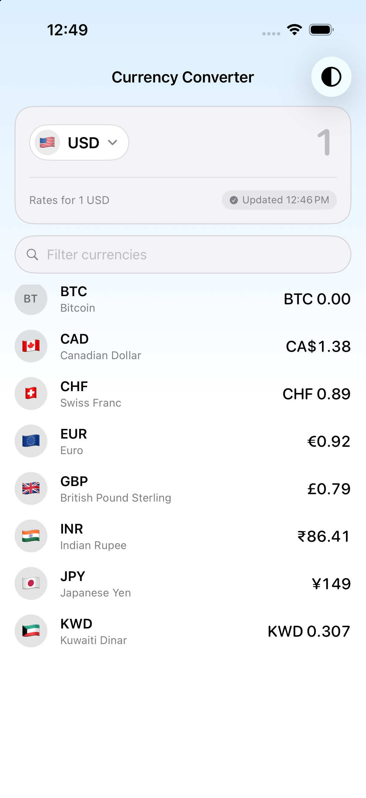
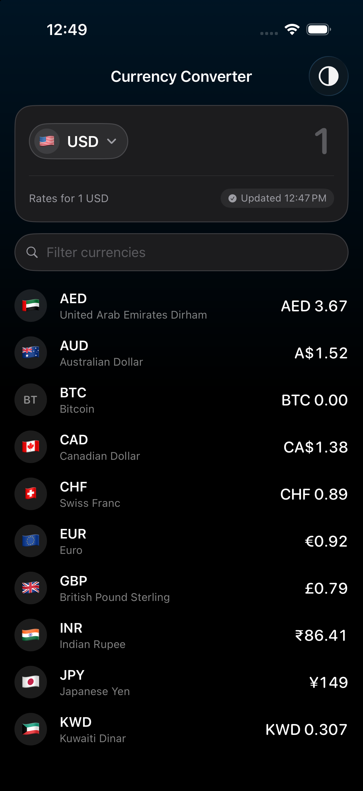

# Currency Converter

[](https://swift.org)
[](https://developer.apple.com/ios/)
[](#testing)
[](LICENSE)

An offline-first currency converter for iOS. Enter an amount, pick a currency,
and see it converted into every currency Open Exchange Rates publishes. Once it
has fetched data it keeps working with no network at all.

Built with SwiftUI and Swift Concurrency, no third-party dependencies.

<p align="left">
  
  
</p>

## Features

- Converts into ~170 currencies at once, recalculating as you type
- Fully usable offline, with a banner explaining how old the data is
- Refreshes the API at most once every 30 minutes, across every trigger
- Searchable currency picker, plus a filter over the results list
- Light, dark and system themes, remembered between launches
- Restores your last amount and currency on relaunch
- Long press any row to copy the value

## Getting started

You need a free Open Exchange Rates App ID:
[openexchangerates.org/signup/free](https://openexchangerates.org/signup/free).

Put it in `Config/Config.xcconfig`:

```
OXR_APP_ID = your_key_here
```

Then open `CurrencyConverter.xcodeproj` and run. Requires iOS 18 and Xcode 16
or newer. A missing key trips an assert on launch in Debug builds, so you find
out immediately rather than wondering why the list is empty.

If you would rather keep the key out of git entirely, uncomment the
`Config/Config.local.xcconfig` line in `.gitignore` and put it there instead.

## How the conversion works

The free API tier locks the base currency to USD, so cross-rate conversion is
done on device by going through USD:

```
converted = amount * rate[target] / rate[base]
```

USD needs no special case, its rate is 1.0. `ConversionEngine` is a plain
struct with no dependencies, which is why it carries the most tests.

Rates that come back as zero, negative, NaN or infinite get their row dropped
rather than rendered. That guard matters more than it looks: arithmetic on a
broken rate still produces a finite number, so a rate of 0 would quietly show
every row as `0.00` rather than failing loudly.

## Structure

```
ConverterView
  └── ConverterViewModel          view state, debounce, banner, restoration
        ├── ConversionEngine      the math, no dependencies
        └── RatesRepository       actor: throttle, cache-first, dedupe
              ├── NetworkClient   URLSession, maps failures to NetworkError
              ├── RatesCache      JSON file in Application Support
              └── DateProviding   injected clock
```

Every boundary is a protocol, injected from `AppEnvironment`. That is the only
file naming concrete types, and it is also where test doubles get swapped in
(`AppEnvironment+Testing.swift`, behind `#if DEBUG`, so none of it ships).

## Refresh rules

Every trigger goes through one method on the repository: cold launch, returning
from the background, pull to refresh, and reconnecting. There is deliberately
no force-refresh flag, so the 30 minute window applies to all of them equally
and nothing can route around it.

| Cache | Network | What happens |
|---|---|---|
| under 30 min | any | served from cache, no network call at all |
| stale | online | cache renders immediately, refresh happens behind it |
| stale | failing | cache renders, banner explains |
| empty | online | skeleton, then content |
| empty | failing | full screen error with retry |

The window is measured from when the app fetched, not from the API's own
timestamp, since the server refreshes on its own schedule. Both live on the
snapshot: the caption shows the API's time, the throttle uses ours.

Concurrent triggers share one task, so launch and reconnect firing together
still make a single request. One caller cancelling does not cancel it for the
others, which is why it is an unstructured `Task` rather than an `async let`.

## Status banner

Rather than a single "offline" flag, the banner covers four combinations:

| | fresh | stale |
|---|---|---|
| online | "Updated 14:02" | "Couldn't update, rates from ..." |
| offline | small offline pill | "Offline, rates from ..." |

Offline with fresh data shows no date, because data under 30 minutes old is the
same thing an online user is looking at.

## Notable decisions

**No third party dependencies.** URLSession, actors and Swift Testing cover
everything here. Writing `MockURLProtocol` and a small JSON store by hand was
cheaper than the maintenance cost of adding libraries to a project this size.

**A JSON file instead of Core Data or SwiftData.** The whole dataset is one
snapshot of about 10 KB, replaced wholesale on refresh. No queries, no partial
updates, so a database would be modelling and migration work for nothing. It
lives in Application Support rather than Caches because the OS purges Caches
under storage pressure, which would silently break offline support.

**Double, not Decimal.** Floating point error is acceptable for a rates display.
Production money handling should use `Decimal` or integer minor units, since
binary floating point cannot represent most decimal fractions exactly and the
error compounds when chaining conversions through USD. `ConversionEngine` is a
pure function of `(amount, base, rates)`, so changing the numeric type later is
a one file change.

**One error type.** `NetworkError` covers transport, HTTP status and decoding
failures so the view model never sees a `URLError`. Only `cancelled` changes
behaviour; it is swallowed, because a cancelled debounce is not something to
show a user. The one wart is `conversionUnavailable`, which the engine throws
and is not a network error at all. It belongs in its own type and I would split
it the moment a second domain error appeared.

**Debounce via `.task(id:)`.** Typing recomputes after about 250 ms. Changing
the task id cancels the previous run, so debouncing and cancelling stale work
are the same mechanism instead of two. The interval is injected so tests do not
wait on it.

## Input handling

Paste stays enabled on the amount field, since copying a number out of a message
is half of what a converter is for. That puts the burden on `AmountSanitizer`,
which keeps ASCII digits and the first decimal separator and drops everything
else: currency symbols, grouping separators, minus signs, letters, emoji.
Non-ASCII digits are dropped rather than kept, because `Double` cannot parse
them and keeping them would silently convert as zero. Input is capped at 12
integer and 6 fraction digits.

An empty field is a state rather than an error: it shows what one unit buys. A
typed 0 shows zeros, because that is what was asked for.

## Testing

52 tests, none of which touch the network.

```
xcodebuild -project CurrencyConverter.xcodeproj -scheme CurrencyConverter \
  -destination 'platform=iOS Simulator,name=iPhone 17 Pro' test
```

No App ID is needed to run them. The 49 unit tests use mocks and
`MockURLProtocol`; the 3 UI tests launch with `-uiTesting`, which swaps a stub
network in at the composition root.

The split is deliberate. Unit tests carry the behaviour: the conversion maths,
the throttle (including a test asserting the network was *not* called),
concurrent triggers collapsing into one request, offline fallback, error
mapping, and every view model state. The UI tests only prove the screen is
wired to the view model, because UI tests are slow and the flakiest thing in
any suite.

The clock is injected, which is what makes it possible to test a 30 minute
window without waiting 30 minutes.

## Known gaps

**The window trusts the device clock.** Moving the clock forward causes a
harmless refetch. Moving it backward makes cached data look permanently fresh
and stalls refreshes until real time catches up. The fix is to take the
server's time once per launch, either from the `timestamp` in `latest.json` or
the HTTP `Date` header, and measure against that offset. All time already goes
through the injected `DateProviding`, so it is contained, but it needs a
successful response to anchor to, which makes the first-launch-offline case its
own decision.

**No localization.** English only. For a real currency app this would not be
optional. What is locale aware is the part affecting correctness rather than
translation: amount parsing (a German user typing `1,5` means 1.5), currency
formatting so JPY shows no decimals and KWD shows three, the default currency
on first launch, and diacritic insensitive search.

**Values that round to zero display as 0.00.** A fraction of a Bitcoin shows as
`BTC 0.00` rather than switching to significant digits.

**Reachability is NWPathMonitor's view of the world.** A captive portal looks
online until a request actually fails, at which point it follows the normal
stale-data path.

iPhone first. Landscape and iPad run but have no dedicated layout.

## License

MIT, see [LICENSE](LICENSE).

Rates from [Open Exchange Rates](https://openexchangerates.org).
